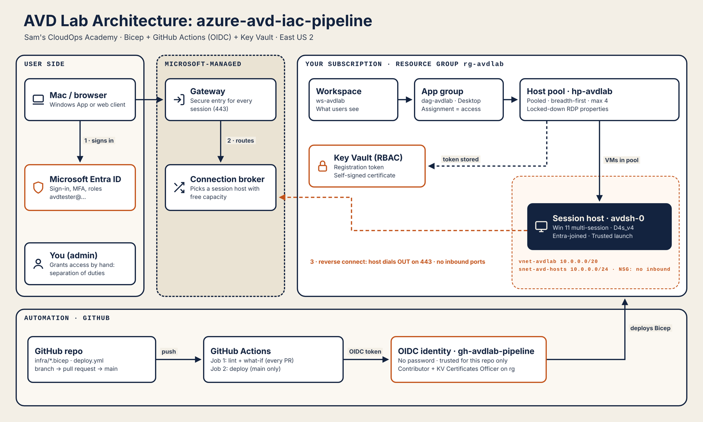
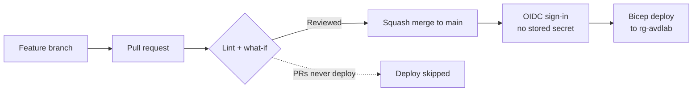

# Azure Virtual Desktop as Code

**Secure Azure Virtual Desktop (AVD) deployed with Bicep and a GitHub Actions pipeline that signs in to Azure with OIDC, so no passwords or client secrets are stored anywhere.**


-2F6B4F)

---

## Overview

This project builds a Windows 11 multi-session cloud desktop in Azure (East US 2). The user signs in from a Mac or a browser and gets a locked-down desktop. The environment is described in Bicep, reviewed through pull requests and deployed by a pipeline. The pipeline holds **least-privilege** permissions on a **single resource group**.

I built the lab twice: once by hand in the Azure portal to understand every component, then as Infrastructure as Code. I also tore it down and rebuilt it with the scripts in this repo.

| | |
|---|---|
| **Cloud** | Microsoft Azure: AVD, Virtual Network, NSG, Key Vault, Entra ID |
| **IaC** | Bicep (modular: network, Key Vault, AVD control plane) |
| **CI/CD** | GitHub Actions: lint → what-if → deploy, gated on `main` |
| **Identity** | OIDC workload identity federation, Azure RBAC, Entra-joined session host |
| **Scripting** | Bash + Azure CLI + GitHub CLI (idempotent setup, preflight checks and teardown) |

---

## Architecture



**How a user connects**
1. The user opens Windows App (or the web client) and signs in with Microsoft Entra ID.
2. The AVD feed shows only the desktops the user is **assigned** to.
3. The Microsoft-managed gateway and broker pick a session host in the host pool.
4. The session host has **no public IP and no inbound ports**. Its agent has already dialed **out** to Azure over HTTPS 443 (reverse connect), so the connection rides that outbound link.
5. The Entra-joined VM checks that the user has the **Virtual Machine User Login** role, then opens the desktop.

**How the infrastructure changes**


---

## Security by design

| Control | How it is implemented | Why it matters |
|---|---|---|
| **No pipeline secrets** | GitHub OIDC → Entra federated credentials. Tokens are short-lived and scoped to this repo and branch. | Nothing to leak, rotate or steal from the repo. |
| **Repo-resurrection protection** | Federated credentials also trust the **immutable-ID** subject format (`owner@id/repo@id`). | A deleted and re-created repo with the same name cannot inherit the trust. |
| **Least privilege for the pipeline** | Contributor + Key Vault Certificates Officer on **one resource group** only. | The pipeline cannot touch other resources and **cannot assign roles**. |
| **Separation of duties** | User access is granted by an admin script, not by the pipeline. | Compromising CI/CD does not mean you can give yourself access. |
| **PR safety gate** | Pull requests run lint + what-if only. Deploy runs only from `main`. | Every change is previewed and reviewed before it reaches Azure. |
| **Secrets never in outputs** | The AVD registration token is written **straight into Key Vault** with an expiry and is never a deployment output. | Deployment history is readable by anyone with Reader access. |
| **Key Vault data plane locked** | RBAC mode. Even the subscription Owner gets `ForbiddenByRbac` on secrets. | Managing resources and reading their data are separate permissions. |
| **Zero inbound exposure** | No public IP, NSG with default deny-inbound, reverse connect on 443. | No RDP port exposed to the internet to scan or brute-force. |
| **Data-exfiltration controls** | RDP properties block clipboard, drive and printer redirection. | Data stays inside the cloud desktop. |
| **Short-lived registration** | The host pool token expires in 8 hours. | A leaked token is useless after the build window. |
| **Drift correction** | what-if runs on every change. Redeploying from `main` restores the reviewed state. | Manual portal changes are visible and reversible. |

---

## Repository structure

```
azure-avd-iac-pipeline/
├── .github/workflows/deploy.yml     # CI/CD: lint → what-if → deploy (OIDC)
├── infra/
│   ├── main.bicep                   # Entry point: wires the modules together
│   └── modules/
│       ├── network.bicep            # VNet 10.0.0.0/20, subnet /24, NSG
│       ├── keyvault.bicep           # Key Vault (RBAC, soft delete)
│       └── avd.bicep                # Host pool, app group, workspace, token → Key Vault
├── scripts/
│   ├── setup-identity.sh            # App registration, federated credentials, scoped roles, GitHub secrets
│   ├── preflight-vm.sh              # Checks VM size availability + vCPU quota before deploying
│   ├── assign-access.sh             # Creates test user, assigns least-privilege AVD roles
│   └── teardown.sh                  # Removes everything, purges Key Vault, cleans Entra + GitHub
└── docs/architecture.png
```

---

## Deploy it yourself

**Prerequisites:** Azure subscription (Owner), Azure CLI with Bicep, GitHub CLI, Git.

```bash
# 1. Sign in and create the only resource group the pipeline may touch
az login
az group create --name rg-avdlab --location eastus2 \
  --tags Project=avd-iac-pipeline Environment=Lab Owner=Sam

# 2. Create the passwordless pipeline identity and GitHub secrets (idempotent)
bash scripts/setup-identity.sh

# 3. Run the pipeline
gh workflow enable deploy.yml
gh workflow run deploy.yml --ref main

# 4. Check VM size + quota, then add the session host (portal host pool wizard)
bash scripts/preflight-vm.sh Standard_D4s_v4

# 5. Create the test user and assign access
bash scripts/assign-access.sh

# 6. Tear it all down when finished
bash scripts/teardown.sh
```

> Edit the settings block at the top of each script (repo name, resource group) to match your environment.

---

## Problems I solved along the way

| Problem | Root cause | Fix |
|---|---|---|
| `AADSTS700213: No matching federated identity record` | GitHub sent the immutable-ID subject claim, but Azure only trusted the classic `repo:owner/repo` format. | Compared the subject claim in the run log with the credential and trusted both formats. The setup script now does this automatically. |
| `QuotaExceeded` for `standardDASv5Family` (limit 0) | Quota is per VM family, per region. | Wrote `preflight-vm.sh` to check SKU restrictions and free vCPUs **before** deploying, then switched to `Standard_D4s_v4`. |
| `ResourceDeploymentFailure` with no detail | A wrapper error that hides the nested failure. | Read the inner error with `az deployment operation group list` and cleaned up an orphaned NIC. |
| macOS client could not reach the Entra-joined host | Missing `targetisaadjoined:i:1` RDP property. A change had not actually reached `main`. | Fixed the change in code and shipped it through a PR. Now I check `git diff` before every commit. |
| Node.js 20 deprecation in Actions | Old action versions. | Upgraded to `actions/checkout@v7` and `azure/login@v3`. |
| Portal wizard settings appearing in what-if | Configuration drift from adding the session host in the portal. | Pipeline redeploy restores the reviewed state. Next step: move the session host into Bicep. |

---

## What I would add next

- Session hosts in Bicep (VM, Entra join extension, AVD agent) for a fully code-built environment
- FSLogix profiles on Azure Files with private endpoints
- Conditional Access (MFA, compliant device) for AVD sign-in
- Scaling plan to stop idle hosts and cut cost
- GitHub Environments with required reviewers before production deploys
- Policy-as-code (Azure Policy) and IaC scanning (e.g. Checkov or PSRule) in the pipeline

---

## Author

**Akpoebi Samuelson Atti (Sam)**, Sam's CloudOps Academy
CompTIA Network+ · CompTIA Security+ · Microsoft AZ-900

[GitHub](https://github.com/attisammy)
